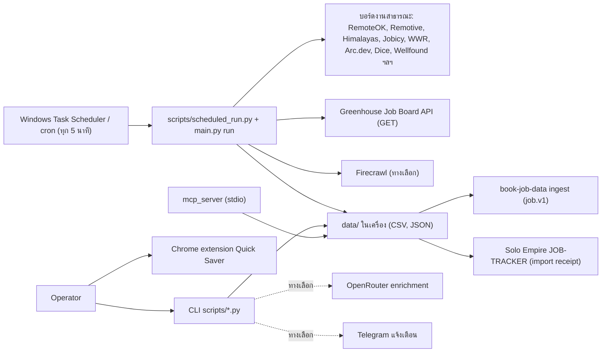
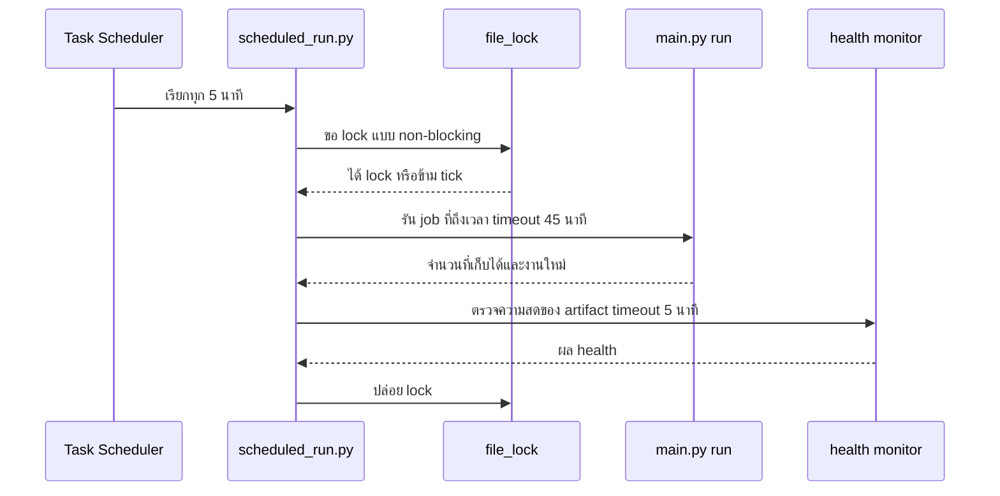

# Book Job Scraping — System Architecture

## 1. Context diagram

## 2. Components

| Component | Path | หน้าที่ |
|---|---|---|
| Composition root / CLI | `main.py` | คำสั่ง `run [job]`, `status`, `enable`, `disable` ของ scheduler |
| Core (domain) | `core/models.py`, `core/ports.py`, `core/use_cases.py`, `core/pipeline/` (cleaner, deduplicator), `core/atomic_io.py`, `core/config.py` | model, port, `ScrapeUseCase`, `SearchUseCase`, ทำความสะอาดข้อความไทย, dedup ด้วย content hash, เขียนไฟล์แบบ atomic |
| Inbound adapters | `adapters/inbound/scheduler_adapter.py`, `mcp_server/server.py` | scheduler จาก YAML (`data/schedule_state.json`), MCP tools |
| Outbound adapters | `adapters/outbound/engine_adapter.py`, `engines/` (httpx+BS4, Playwright, Selenium, Scrapy, RSS), `exporter_adapter.py`, `storage_adapter.py` | engine และ export JSON/CSV/SQLite/Parquet |
| Job pipeline scripts | `scripts/scrape_job_postings.py`, `career_discovery.py`, `filter_job_matches.py`, `scrape_job_descriptions.py`, `auto_seed_tracker.py`, `application_review.py`, `multi_resume_manager.py`, `auto_apply.py`, `tailor_resume.py` | capture → match → review → prepare |
| Policy | `scripts/job_target_policy.py`, `config/job_targeting.yaml`, `scripts/safety.py`, `scripts/http_policy.py`, `scripts/source_coverage.py` | PASS/VERIFY/REJECT, send gate, rate limit/retry, terms registry |
| Ops | `scripts/scheduled_run.py`, `scripts/file_lock.py`, `scripts/pipeline_health_monitor.py`, `scripts/pipeline_runner.py`, `ops/windows/scheduled-task.ps1`, `setup_cron.sh`, `ops/systemd/*.example` | รันตามตาราง, lock, timeout, health |
| Gated senders | `send_application_emails.py`, `email_application.py`, `auto_send_email.py`, `send_followup_emails.py`, `ats_auto_apply.py` | ส่งจริง — ล็อกโดยค่าเริ่มต้น |
| Secondary lanes | `property/`, `chrome-extension/`, `scripts/import_property_leads.py`, `import_facebook_group_posts.py`, discovery scrapers | รอย้ายไป repo เจ้าของ |
| Contracts | `contracts/property-capture.v1.json`, `property-demand.v1.json`, `facebook-group-post.v1.json` | schema ของ lane property/social |

## 3. Tech stack

| ชั้น | เทคโนโลยี |
|---|---|
| ภาษา | Python 3.11 (CI) |
| HTTP/parse | httpx, requests, BeautifulSoup4, lxml, feedparser |
| Browser | Playwright (Chromium), Selenium |
| Config | PyYAML (scheduler ในตัว ไม่ใช้ APScheduler) |
| Optional | scrapy, pydantic, mcp |
| Extension | Chrome Manifest V3 (`Quick Saver — Jobs & Property Leads` 1.1.0) |
| Test/lint | pytest, unittest, ruff (เฉพาะ E9/F63/F7/F82) |

## 4. Data stores

ทั้งหมดเป็นไฟล์ใน `data/` (gitignore ยกเว้น `.gitkeep`)

| ไฟล์ | เนื้อหา | ผู้ใช้ปลายทาง |
|---|---|---|
| `job_postings.csv` | snapshot ล่าสุดทุกแหล่ง | match, `book-job-data` |
| `job_postings_history.csv` | บันทึกงานครั้งแรกที่เห็น | dedup |
| `career_postings.csv` | capture จาก Greenhouse | match |
| `matched_jobs.csv` | ผลจัดประเภท + lane/description evidence | review, `book-job-data` (`job_matches`) |
| `job_descriptions.csv` | รายละเอียดงานอันดับต้น | review |
| `apply_tracker.csv` | tracker เดิม (`discovered`/`prepared`) | operator |
| `career-review/<dir>/<JOB_ID>/` | snapshot, checklist ไทย, `verification.json`, `prepared.json` | operator |
| `confirmed_applications.json` | ใบสมัครที่ยืนยันด้วย receipt + follow-up | JOB-TRACKER |
| `schedule_state.json`, `cron.log` | สถานะ scheduler, log (rotate ที่ 5 MB) | ops |
| `briefings/scraper_dashboard.json` | snapshot dashboard | operator |

CSV column contract ที่ `book-job-data` ใช้ยังไม่ถูกเขียนใน repo นี้ **[ต้องยืนยัน]** (อ้าง `systems/architecture/job-data-contract-v1.yaml` ใน Solo Empire)

## 5. Integrations

| ระบบ | ทิศทาง | หมายเหตุ |
|---|---|---|
| บอร์ดงาน / API สาธารณะ | ขาเข้า | ผ่าน `http_policy.py`: 1 request ต่อ host ต่อ `rate_limit` วินาที, retry ≤ 3 ครั้งบน 429/5xx เคารพ `Retry-After` (สูงสุด 60 วินาที) |
| Greenhouse Job Board API | ขาเข้า (GET) | ไม่ใช้ API key; ล้มทั้งชุดโดยไม่ทับ capture เดิมเมื่อบอร์ดใดล้ม |
| Firecrawl | ขาเข้า | ต้องมี `FIRECRAWL_API_KEY` |
| OpenRouter | ขาออก (ทางเลือก) | enrichment; ไม่จำเป็นต่อ health |
| Telegram | ขาออก (ทางเลือก) | `--send-telegram` เมื่อได้รับอนุมัติ |
| `book-job-data` | ไฟล์ | `python -m book_job_data.ingest --input .../job_postings.csv` |
| Solo Empire JOB-TRACKER | ไฟล์ | `infra/scripts/opportunities/import_job_applications.py` (metadata เท่านั้น) |

### 5.1 ลำดับ tick ของ scheduler

## 6. Deployment topology

- เครื่อง operator เครื่องเดียว (Windows ตั้งแต่ 2026-09-30) ใช้ `.venv` ของ repo
- Linux ใช้ `setup_cron.sh` ที่มีความหมายเดียวกัน
- ไม่มี server, container หรือ live URL; MCP server รันแบบ local process

## 7. ADR สำคัญ

| ID | การตัดสินใจ | เหตุผล | หลักฐาน |
|---|---|---|---|
| ADR-01 | Hexagonal (ports & adapters) | แยก engine ออกจาก domain | `README.md` §Architecture |
| ADR-02 | Producer เท่านั้น — ไม่เขียน DB ของระบบอื่น, ไม่เรียก API ของ Solo Empire | ขอบเขตชัด, lake-first | `BOUNDARY.md`, `PRODUCT.md` |
| ADR-03 | Live send ต้องผ่าน CLI flag + 2 env unlock + `PASS` + `APPROVED` | ป้องกันการส่งโดยไม่ตั้งใจ | `SAFETY.md` |
| ADR-04 | Contract-first targeting (PASS/VERIFY/REJECT) | กันงานที่ขัดกับสถานะการจ้างงาน | `config/job_targeting.yaml` |
| ADR-05 | Manual ATS submission เป็นเส้นทางที่รองรับ + receipt | automation ข้าม ATS ไม่ได้รับรอง | `CAREER-WORKFLOW.md` |
| ADR-06 | API/RSS ก่อน scraping; ทุกบอร์ดต้องมี terms decision | ความถูกต้องตามกฎ/ToS | `config/source_coverage.yaml` |
| ADR-07 | ย้าย lane ที่ไม่ใช่งานไป repo เจ้าของ | ลดขอบเขต | `BOUNDARY.md` (2026-09-30) |

## การอนุมัติ

| บทบาท | สถานะ | วันที่ | ลงนาม |
|---|---|---|---|
| Solution Architect (Book Dev) | รอตรวจ | — | [ต้องยืนยัน] |

## แหล่งข้อมูล

- `README.md`, `PRODUCT.md`, `BOUNDARY.md`, `SAFETY.md`, `CAREER-WORKFLOW.md`
- `main.py`, `core/`, `adapters/`, `mcp_server/server.py`, `scripts/`, `chrome-extension/manifest.json`
- `config/*.yaml`, `ops/`, `setup_cron.sh`, `requirements.txt`, `.github/workflows/ci.yml`
