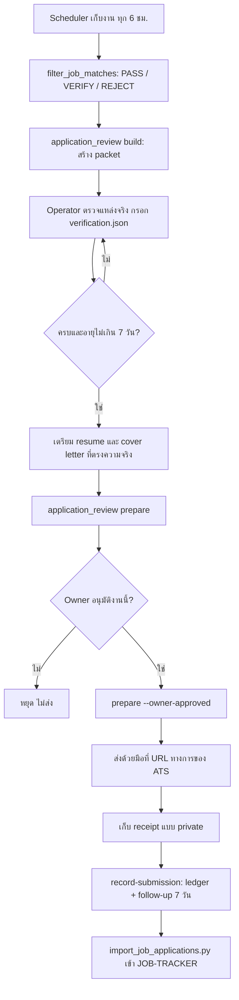
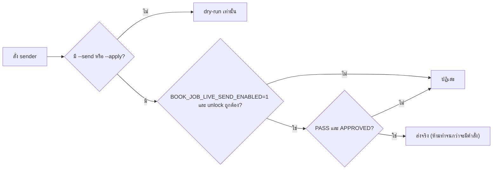
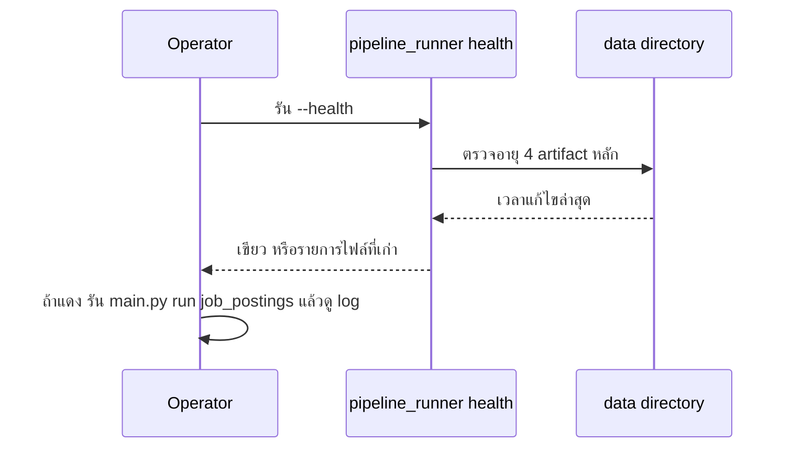

# Book Job Scraping — User Flow และ Screen Inventory

## 1. รายการหน้าจอ / พื้นผิวการใช้งาน

ไม่มี web app; พื้นผิวคือ CLI, ไฟล์ review packet, Chrome extension และ MCP

| ID | พื้นผิว | ชื่อ | บทบาท | สถานะ |
|---|---|---|---|---|
| SC-01 | `main.py status` | สถานะ scheduler | Operator | มีแล้ว |
| SC-02 | `pipeline_runner.py --health` / health monitor | Health report (console) | Operator | มีแล้ว |
| SC-03 | `data/career-review/current/README.md` + `<JOB_ID>/` | Review packet (snapshot, checklist ไทย, `verification.json`) | Operator | มีแล้ว |
| SC-04 | `application_review.py prepare` / `record-submission` | Prepare และบันทึกการสมัคร | Operator / Owner | มีแล้ว |
| SC-05 | `matched_jobs.csv` ในโปรแกรม spreadsheet | รายการงานที่จัดประเภทแล้ว | Operator | มีแล้ว |
| SC-06 | `scraper_dashboard.py` → console + JSON | Dashboard รวม scraper | Operator | มีแล้ว |
| SC-07 | `job_dashboard.py`, `pipeline_dashboard.py` | Dashboard อื่น | Operator | มีโค้ด; การใช้งาน **[ต้องยืนยัน]** |
| SC-08 | Chrome extension popup (`popup.html`) | Quick Saver — Jobs & Property Leads | Operator | มีแล้ว (lane property/FB) |
| SC-09 | MCP tools | ค้นข้อมูลผ่าน AI agent | AI agent | มีแล้ว |
| SC-10 | Solo Empire `JOB-TRACKER.md` | บันทึกใบสมัครที่ยืนยันแล้ว | Owner | นอก repo |

## 2. User flow หลัก

### 2.1 จากประกาศงานถึงใบสมัครที่มีหลักฐาน

### 2.2 Gate ของ sender เดิม

### 2.3 Health รายวัน

## 3. Design system / component

- ไม่มี design system ของ UI; ข้อความ CLI และ checklist ใน packet เป็นภาษาไทย/อังกฤษผสม
- Review packet: โครงสร้างคงที่ (snapshot, checklist ไทย, `verification.json`, `prepared.json`) และ immutable หลัง prepare
- Chrome extension: popup + content script + background (MV3), ส่งออก CSV ผ่าน `downloads`
- หลักการ UX: ค่าเริ่มต้นปลอดภัย (dry-run), ไม่เดาข้อมูลที่ไม่รู้ (เงินเดือน, notice period, คำถามเฉพาะบริษัท), สถานะชัด (`discovered` → `prepared` → `submitted` เฉพาะส่งจริง)

## การอนุมัติ

| บทบาท | สถานะ | วันที่ | ลงนาม |
|---|---|---|---|
| UX/UI (Book Dev) | รอตรวจ | — | [ต้องยืนยัน] |

## แหล่งข้อมูล

- `CAREER-WORKFLOW.md`, `SAFETY.md`, `README.md` §Collection health
- `scripts/application_review.py`, `scripts/scraper_dashboard.py`, `chrome-extension/`, `mcp_server/server.py`
